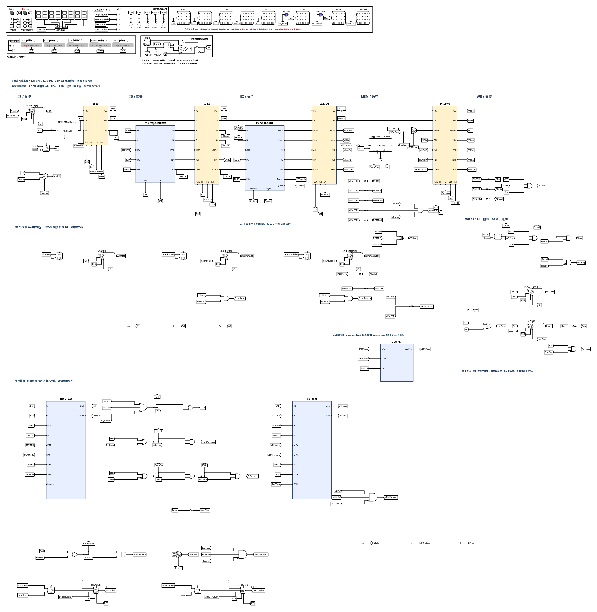

# Vibe Logisim

**和 AI 一起搭电路、跑仿真、找问题。**

一个数字电路工作台：画图、仿真、看资料、和 AI 对话都在同一个窗口里。你可以自己画，也可以把需求说给 AI，让它实现电路、解释原理、排查错误，改动随时可以撤销。成果是普通的 `.circ` 文件，Logisim-ITA 2.16 和 HUST 2020 版的电路都能直接打开。

[下载](https://github.com/FIY-pc/vibe-logisim/releases/latest) · [产品介绍](https://lovej.site/vibe-logisim/) · [反馈问题](https://github.com/FIY-pc/vibe-logisim/issues/new/choose)

[](docs/images/circuit-example.png)

- **用自然语言搭电路。** 「搭一个一位全加器，验证真值表，解释进位怎么产生」，AI 直接改在画布上。
- **边跑边查。** 切输入、推时钟、追踪信号来源；选中一块电路让 AI 解释连接或找错。
- **资料就在手边。** 把需求文档、组件库放进工程文件夹，PDF、PPT、图片在工作台里看，直接引用进对话。

## 安装

到 [Releases](https://github.com/FIY-pc/vibe-logisim/releases/latest) 下载对应系统的包。包里已带 Java 和 Node.js，不用另装。

| 系统 | 下载 | 打开 |
| --- | --- | --- |
| Windows 10/11 x64 | `…-win32-x64-setup.exe` | 安装后从开始菜单打开 |
| Windows 便携版 | `…-win32-x64.zip` | 解压，运行 `start.cmd`（需要 WebView2） |
| Linux x64 | `…-linux-x64.deb` 或 `…-linux-x64.tar.gz` | 安装 deb，或解压后运行 `start.sh`（需要 GTK3、WebKitGTK 4.1） |
| macOS 13.5+ | 暂无安装包，按[构建说明](docs/distribution.md#构建与产物)自行生成 | 把 `Vibe Logisim.app` 放入「应用程序」 |

打开就能画图和仿真。要用 AI，在右侧「连接 AI」登录 ChatGPT 或填自己的 API 服务。

## 参与开发

Rust、Tauri 2、React 19、TypeScript。装好 Node.js 24、rustup、JDK 17+ 和 [Tauri 平台依赖](https://v2.tauri.app/start/prerequisites/)，然后：

```sh
npm ci
npm run setup
npm run desktop
```

从 [开发说明](docs/development.md) 开始；[架构](docs/architecture.md)、[分发构建](docs/distribution.md)、[课堂服务](docs/classroom.md) 在 docs/。

## 许可

[GPL-3.0](LICENSE)。安装包内第三方组件的许可见 [THIRD_PARTY.md](THIRD_PARTY.md)。
